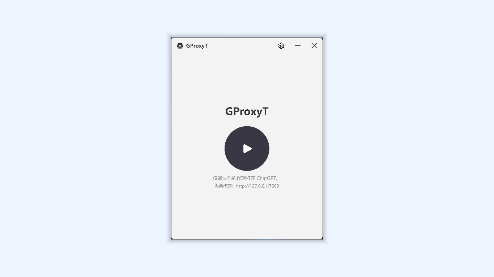

# GProxyT

**English** | [简体中文](README.zh-CN.md)

[](https://github.com/w0fv1/gproxyt/actions/workflows/build.yml)
[](https://github.com/w0fv1/gproxyt/releases)
[](LICENSE)

GProxyT is a lightweight Windows launcher that starts the Microsoft Store ChatGPT/Codex desktop app with a process-level proxy. It passes proxy arguments to the app's Chromium network stack without changing the Windows system proxy or affecting other applications.

GProxyT is an independent third-party project. It is not affiliated with, sponsored by, or endorsed by OpenAI or Microsoft. ChatGPT, Codex, and related marks belong to their respective owners.



## Features

- HTTP, HTTPS, and SOCKS5 proxy endpoints
- No system proxy or environment variable changes
- Package-identity discovery and activation without direct access to protected `WindowsApps` files
- Optional restart of an existing desktop app process
- Optional launch at Windows sign-in
- Desktop shortcut creation
- Local settings and rotating local logs
- 20 interface languages, including right-to-left layout for Arabic

The default proxy is `http://127.0.0.1:7890`.

## Requirements

- Windows 10 version 2004 or later, or Windows 11
- x64 processor
- The current Microsoft Store ChatGPT/Codex desktop app
- An HTTP, HTTPS, or SOCKS5 proxy you control or trust

Administrator privileges are not required. Install the official desktop app from Microsoft Store or with:

```powershell
winget install Codex -s msstore
```

## Install

Choose one distribution:

- [Microsoft Store](https://apps.microsoft.com/detail/9P3M0G0LP9ZD) for managed installation and updates.
- [GitHub Releases](https://github.com/w0fv1/gproxyt/releases/latest) for the portable `gproxyt.exe`.
- [GProxyT download page](https://next.firco.cn/release/gproxyt) for the project-hosted portable build.

The GitHub executable is currently unsigned, so Windows SmartScreen may ask you to confirm that you trust it. You can verify it against `SHA256SUMS.txt` or `SHA512SUMS.txt` from the same release.

Run `gproxyt.exe`, review the proxy address in Settings, and select the launch button. Running GProxyT again restores the existing window instead of creating a second instance in the same Windows session.

GProxyT waits up to 30 seconds for the ChatGPT window to appear, allowing for slower startup after an update. If launch fails, the error dialog shows the specific reason and log file path; a launch failure does not necessarily mean ChatGPT is missing.

## Command line

Launch the desktop app immediately:

```powershell
gproxyt.exe --launch
```

Create a desktop shortcut:

```powershell
gproxyt.exe --create-shortcut
```

Enable diagnostic logging for the current run:

```powershell
gproxyt.exe --debug --launch
```

Settings are stored in `%APPDATA%\gproxyt\settings.json`. Error logs are stored in `%LOCALAPPDATA%\gproxyt\logs`, rotate daily or at 10 MB, and are retained for 14 days. Logs are never uploaded automatically.

## Proxy scope

GProxyT passes Chromium's `--proxy-server` and loopback bypass arguments to the Store app. It does not modify the system proxy or user environment variables.

When restart is enabled, GProxyT only stops processes belonging to the registered `OpenAI.Codex` Store package family. It does not stop VS Code extensions or unrelated Codex installations. Package activation uses the registered package identity and AUMID, so GProxyT does not directly execute protected files under `WindowsApps`.

## Localization

GProxyT follows the Windows display language and falls back to English. The supported languages are Arabic, Brazilian Portuguese, Chinese (Simplified and Traditional), Dutch, English, French, German, Hindi, Indonesian, Italian, Japanese, Korean, Polish, Russian, Spanish, Thai, Turkish, Ukrainian, and Vietnamese.

Localization files are in `src/Gproxyt/Resources/Strings.<culture>.json`. All files must keep the same key set; automated tests enforce this contract.

## Build from source

Install PowerShell 7 and the .NET SDK selected by [`global.json`](global.json), then run on Windows:

```powershell
./build.ps1
```

The script runs all .NET and PowerShell tests before publishing a self-contained Windows x64 single-file build:

```text
dist\gproxyt.exe
```

To create the unsigned Microsoft Store MSIX, install the Windows App Development CLI and run:

```powershell
winget install --id Microsoft.WinAppCli --exact --source winget
./store-build.ps1
```

Store identity and packaging details are maintained in [`packaging/microsoft-store.md`](packaging/microsoft-store.md).

## Releases

The version is maintained only in `src/Gproxyt/Gproxyt.csproj`. A `v` or `V` tag whose remainder exactly matches that version triggers the release workflow. The tag must point to a commit on `main`.

For example:

```powershell
git tag v1.7.4-stable
git push origin v1.7.4-stable
```

The workflow tests and builds the project, creates SHA-256 and SHA-512 checksum files, and publishes all three artifacts to GitHub Releases. Versions not ending in `-stable` are marked as prereleases.

## Privacy

GProxyT requires no account and does not collect, upload, sell, or share personal data. Proxy settings and logs remain under the current Windows user profile. See the public [privacy policy](https://next.firco.cn/gproxyt/privacy) for distribution-specific details.

## Contributing and security

See [CONTRIBUTING.md](CONTRIBUTING.md) before opening a pull request. Report vulnerabilities privately as described in [SECURITY.md](SECURITY.md), not through a public issue.

Third-party license information is in [THIRD-PARTY-NOTICES.md](THIRD-PARTY-NOTICES.md). GProxyT is released under the [MIT License](LICENSE).
