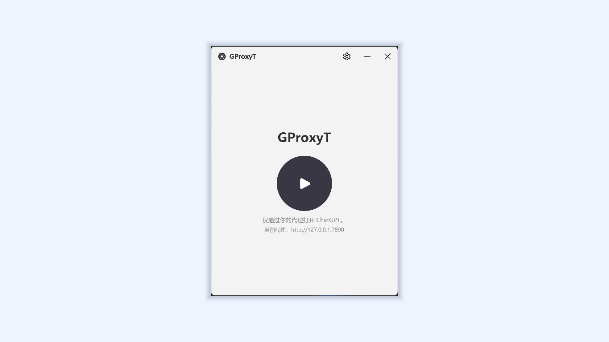

# GProxyT

[English](README.md) | **简体中文**

[](https://github.com/w0fv1/gproxyt/actions/workflows/build.yml)
[](https://github.com/w0fv1/gproxyt/releases)
[](LICENSE)

GProxyT 是 Windows ChatGPT 桌面应用的独立代理启动器。它不修改 Windows 系统代理，通过 Windows 程序包身份启动 ChatGPT，并为 Chromium 网络栈传入代理参数。

GProxyT 是独立的第三方项目，与 OpenAI 或 Microsoft 不存在隶属、赞助或认可关系。ChatGPT、Codex 及相关标志归其各自权利人所有。



默认代理：

```text
http://127.0.0.1:7890
```

## 前置条件

- Windows 10 版本 2004 或更高版本，或 Windows 11
- x64 处理器
- Microsoft Store 当前版 ChatGPT/Codex 统一桌面应用
- 自己控制或信任的 HTTP、HTTPS 或 SOCKS5 代理

不需要管理员权限。GProxyT 通过 Windows 程序包身份和 AUMID 激活官方应用，不直接执行受保护的 `WindowsApps` 文件。

官方应用可以使用以下命令安装：

```powershell
winget install Codex -s msstore
```

## 安装

可以选择以下发行渠道：

- [Microsoft Store](https://apps.microsoft.com/detail/9P3M0G0LP9ZD)：由商店管理安装与更新。
- [GitHub Releases](https://github.com/w0fv1/gproxyt/releases/latest)：下载便携版 `gproxyt.exe`。
- [GProxyT 下载页](https://next.firco.cn/release/gproxyt)：下载项目托管的便携版本。

GitHub 提供的 EXE 目前没有代码签名，因此 Windows SmartScreen 可能要求确认是否信任。可以使用同一 Release 中的 `SHA256SUMS.txt` 或 `SHA512SUMS.txt` 校验文件。

## 使用

运行 `gproxyt.exe`，点击窗口中央的启动按钮。

启动时最多等待 30 秒让 ChatGPT 窗口出现，以适应更新后的较慢启动。如果启动失败，错误对话框会显示具体原因和日志文件路径；启动失败不一定表示未安装 ChatGPT。

普通窗口模式为当前 Windows 会话单实例。再次运行时不会创建第二个窗口，而是还原并置前已经打开的 GProxyT。

右上角设置按钮可以修改代理 URL 和开机自启。开机自启只写入当前用户的 Windows Run 项，并使用 `--launch` 直接通过代理启动 ChatGPT。

命令行直接启动：

```powershell
gproxyt.exe --launch
```

运行错误和未处理异常会自动记录到 `%LOCALAPPDATA%\gproxyt\logs`。日志按天或达到 10 MB 时滚动，并自动清理超过 14 天的文件。需要更多启动诊断信息时添加 `--debug`：

```powershell
gproxyt.exe --debug --launch
```

命令行创建快捷方式：

```powershell
gproxyt.exe --create-shortcut
```

配置保存在：

```text
%APPDATA%\gproxyt\settings.json
```

## 从源码构建

安装 PowerShell 7 和 [`global.json`](global.json) 指定的 .NET SDK，然后在 Windows 上运行：

运行：

```powershell
.\build.ps1
```

构建流程先执行全部测试，再发布自包含的 Windows x64 单文件版本：

```text
dist\gproxyt.exe
```

## Microsoft Store

Microsoft Store 使用与独立版本相同的源码、版本和图像资源生成 x64 MSIX。项目版本 `x.y.z-label` 自动映射为商店版本 `x.y.z.0`，商店身份固定为 `LaiqiInfo.GProxyT`。

产品标识、Partner Center 提交记录、商店链接和发布配置统一维护在 [`packaging/microsoft-store.md`](packaging/microsoft-store.md)。

安装 Windows App Development CLI：

```powershell
winget install --id Microsoft.WinAppCli --exact --source winget
```

生成提交 Partner Center 的未签名 MSIX：

```powershell
.\store-build.ps1
```

输出位置：

```text
dist\store\GProxyT_<version>_x64.msix
```

商店版使用 Windows 程序包启动任务实现开机自启，独立版本继续使用当前用户的 Windows Run 项。程序包升级不会依赖版本化的安装路径。

## 国际化

GProxyT 默认跟随 Windows 显示语言，不支持的语言自动回退到英语。界面、无障碍名称和用户错误提示共享同一组嵌入式本地化资源。

当前支持简体中文、繁体中文、英语、西班牙语、法语、德语、日语、韩语、巴西葡萄牙语、俄语、阿拉伯语、印地语、意大利语、荷兰语、土耳其语、波兰语、印尼语、越南语、泰语和乌克兰语。阿拉伯语使用从右到左布局。

所有语言资源位于 `src/Gproxyt/Resources/Strings.<culture>.json`。英语 `en-US` 是回退语言；新增文本时必须同步更新全部语言文件，测试会校验键集合一致。

i18n 运行库的许可证声明见 [`THIRD-PARTY-NOTICES.md`](THIRD-PARTY-NOTICES.md)。

## GitHub 发布

版本只在 `src/Gproxyt/Gproxyt.csproj` 中维护。推送以 `v` 或 `V` 开头、其余部分与项目版本完全一致的 tag 会触发发布；tag 必须指向 `main` 上的提交。

例如：

```powershell
git tag v1.7.4-stable
git push origin v1.7.4-stable
```

GitHub Actions 会运行测试、构建 `gproxyt.exe`、生成 SHA-256 和 SHA-512 校验文件，并将三个文件发布到 GitHub Releases。不以 `-stable` 结尾的版本会标记为预发布版本。

## 隐私

GProxyT 不要求创建账户，不收集、上传、出售或共享个人数据。代理设置只保存在当前 Windows 用户的 `%APPDATA%\gproxyt` 目录，错误与诊断日志保存在 `%LOCALAPPDATA%\gproxyt\logs`，不会自动上传。

## 代理范围

启动器传入 Chromium 的 `--proxy-server` 与 loopback bypass 参数，使 ChatGPT 的 Chromium 网络请求使用指定代理。它不修改系统代理和用户环境变量。

启动前关闭进程时，只匹配 `OpenAI.Codex` Store 包族身份，并覆盖更新前后的所有版本；不会终止 VS Code 扩展或其他位置的 Codex 进程。安装位置只从当前用户已注册的主程序包解析，不会误用仅完成 Stage 的待更新版本。

## 参与贡献与安全报告

提交 Pull Request 前请阅读 [`CONTRIBUTING.md`](CONTRIBUTING.md)。安全漏洞请按 [`SECURITY.md`](SECURITY.md) 私下报告，不要创建公开 Issue。

第三方许可证信息见 [`THIRD-PARTY-NOTICES.md`](THIRD-PARTY-NOTICES.md)。GProxyT 使用 [MIT License](LICENSE) 发布。
